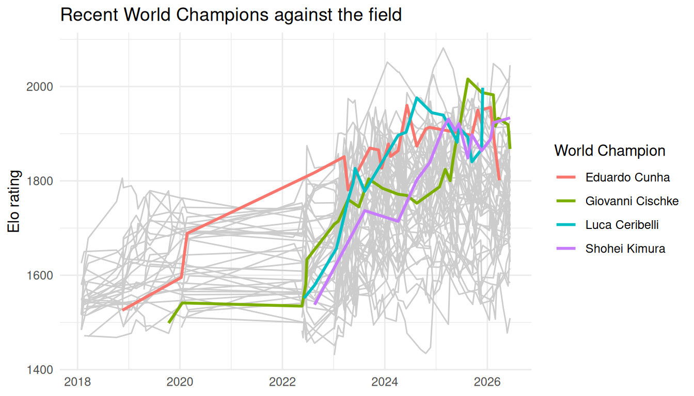

# rescue-an-elo-plot

## Goal

This guide shows how to turn the Elo rating histories in pokemonvgc into
a clear plot that highlights recent World Champions against the rest of
the field.

``` r

library(pokemonvgc)
library(dplyr)
library(ggplot2)
```

## Step 1: Look at the data

`pokemon_elo` contains one row per player per rated event.

``` r

pokemon_elo
#> # A tibble: 2,043 × 4
#>    player_id          player_name        date       rating
#>    <chr>              <chr>              <date>      <dbl>
#>  1 aditya-subramanian Aditya Subramanian 2018-01-28  1484 
#>  2 alberto-lara       Alberto Lara       2018-01-28  1580 
#>  3 alex-underhill     ALEX UNDERHILL     2018-01-28  1484 
#>  4 ashton-cox         Ashton Cox         2018-01-28  1516 
#>  5 carson-confer      Carson Confer      2018-01-28  1626.
#>  6 collin-heier       Collin Heier       2018-01-28  1580 
#>  7 dylan-salvanera    Dylan Salvanera    2018-01-28  1517.
#>  8 ellie-homen        Ellie Homen        2018-01-28  1516.
#>  9 enrique-grimaldo   Enrique Grimaldo   2018-01-28  1549.
#> 10 justin-burns       Justin Burns       2018-01-28  1516.
#> # ℹ 2,033 more rows
```

## Step 2: Mark the recent champions

`recent_champions` is a lookup table, so we use it to flag champions
rather than hard-coding their names.

``` r

elo_flagged <- pokemon_elo |>
  mutate(champion = player_id %in% recent_champions$player_id)
```

## Step 3: Plot champions against the field

Grey lines show the field for context; coloured lines draw attention to
the champions.

``` r

ggplot(elo_flagged, aes(date, rating, group = player_id)) +
  geom_line(
    data = filter(elo_flagged, !champion),
    colour = "grey80"
  ) +
  geom_line(
    data = filter(elo_flagged, champion),
    aes(colour = player_name),
    linewidth = 1
  ) +
  labs(
    x = NULL,
    y = "Elo rating",
    colour = "World Champion",
    title = "Recent World Champions against the field"
  ) +
  theme_minimal()
```



## Step 4: Who is on top now?

[`recent_players()`](https://miriam0085.github.io/pokemonvgc/reference/recent_players.md)
keeps each established player’s latest rating.

``` r

recent_players(pokemon_elo) |>
  slice_max(rating, n = 5)
#> # A tibble: 5 × 5
#>   player_id      player_name    date       rating events
#>   <chr>          <chr>          <date>      <dbl>  <int>
#> 1 wolfe-glick    Wolfe Glick    2026-06-12  2045.     38
#> 2 eric-rios      Eric Rios      2026-06-12  2022.     40
#> 3 paul-chua      Paul Chua      2026-05-29  2008      46
#> 4 marco-silva    Marco Silva    2026-06-12  1999.     45
#> 5 luca-ceribelli Luca Ceribelli 2025-11-29  1997.     19
```

The 2026 champion does not appear in the plot because the rating
snapshot has no history for them. See
[`?recent_champions`](https://miriam0085.github.io/pokemonvgc/reference/recent_champions.md).
